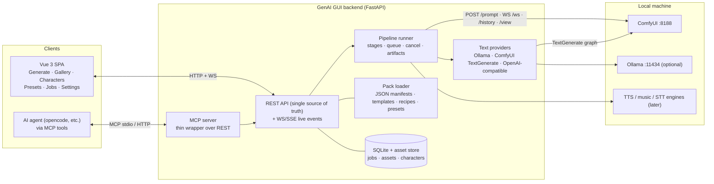

# GenAI GUI — Technical Plan

> Companion to `docs/REQUIREMENTS.md` and `docs/PACKS.md`. Draft v0.2 · 2026-10-17
> Changelog v0.2: GUI-first delivery, feature ladder (one feature per step), agent/MCP architecture, JSON manifests, audio + V2V, workflow→GUI mechanics.

---

## 1. Executive summary

- **Backend (Python/FastAPI)** owns everything stateful: ComfyUI connection, capability probing, recipe/template composition, job pipeline (stages), assets, characters, presets, text providers, MCP server. **The browser and agents never talk to ComfyUI directly.**
- **One API, two clients: the GUI and AI agents (MCP).** Every capability is an API endpoint; the GUI is a client of it, the MCP server is a thin wrapper over it. Nothing exists in the GUI that an agent can't call.
- **ComfyUI is the engine.** Integration via its HTTP + WebSocket API (`127.0.0.1:8188` default). Workflows are authored in ComfyUI exactly as today, then exported as **API-format templates** and wrapped in **packs** (JSON) with parameter bindings + optional blocks. Disabled features = nodes pruned from the graph (true lazy execution) — replaces the IAMCCS switch hack entirely. Details: `docs/PACKS.md`.
- **Generation = ordered stages** (describe → generate → edit → swap → upscale). Every stage artifact persists → debuggable, re-runnable from any point.
- **Everything model-specific is data**: one **JSON manifest per model**, workflow templates, recipes, presets. Adding a model family is a pack, not a code change.
- **Open-source models only, optimized local-first** (my 12GB/32GB machine is the dev target). Cloud adapters come last, as opt-ins.
- **GUI-first build order:** Step 1 is the interface skeleton with mock data; then backend features get wired one at a time (Steps 2–12). One feature per step, each independently shippable + MCP-complete.

## 2. Architecture



**Flow, one generation:** UI (or agent) → `POST /jobs` (recipe + params + assets + flags) → backend composes API-format graph from pack template (enable blocks, bind params, prune disabled) → validates vs live `/object_info` → uploads refs → submits `/prompt` → tracks WS progress → pulls outputs into library → stores job/stages → returns result (id, path, preview URL).

**Agent flow (the "red hat" example):**
1. Agent calls `list_capabilities` → sees `edit_image` available with recipe `qwen_edit`, model present.
2. Agent calls `edit_image { image_path: "D:/photos/me.png", instruction: "add a red hat on the head" }`.
3. App imports the file into the library (hash + thumbnail), picks the recipe, composes the edit graph, runs it.
4. App saves the output asset; returns `{ job_id, status: "done", asset: { id, path, preview_url, metadata } }`.
5. Agent returns the output path/preview to the user, or iterates ("make the hat smaller") by calling the same tool with the returned asset id as input.
6. Long ops (video/audio) use `job_status` polling or MCP progress notifications.

## 3. Stack decision

**Vue 3 + TypeScript + Vite (frontend) · Python 3.11+ FastAPI (backend) · SQLite + files.**

- Python = the local-AI ecosystem language (ComfyUI, safetensors/GGUF parsing, download clients, image ops, later training). FastAPI = async HTTP + WS (ComfyUI progress proxying), pydantic validation, auto OpenAPI docs (feeds the MCP layer and the "API docs" page).
- Vue 3 = fast SPA dev, SFC components everywhere (per requirement), Pinia + Tailwind; frontend build served by FastAPI → **one process** for users.
- MCP: official Python MCP SDK inside the backend; stdio transport for local agents, streamable HTTP for remote.
- Packaging: `uv` dev; release = single `start` script / portable zip; docker-compose optional; ComfyUI stays user-provided.
- Rejected: Gradio/Streamlit (UX ceiling), Node backend (ecosystem), Electron/Tauri (later shell, unnecessary now).
- Frontend libs: Vue 3, Vite, TS, Router, Pinia, Tailwind v4, shadcn-vue (reka-ui), optional @tanstack/vue-query.

## 4. ComfyUI integration contract

### 4.1 Endpoints used (default `http://127.0.0.1:8188`)

| Endpoint | Use |
|---|---|
| `GET /system_stats` | Connectivity; version; device/VRAM |
| `GET /object_info` | Node signatures + model enums (probe fallback) |
| `GET /models`, `/models/{folder}` | Clean model listing (preferred when available) |
| `POST /upload/image` | Push reference images |
| `POST /prompt` | Submit API-format graph → prompt_id + validation errors |
| `GET /history/{prompt_id}` | Outputs (polling fallback) |
| `WS /ws?clientId=…` | Progress (`executing`, `progress`, `executed`, `execution_error`) |
| `GET /view` | Fetch outputs into our library |
| `POST /interrupt`, `POST /free` | Cancel; free VRAM before heavy model switches |
| `GET /queue`, `POST /queue` | Queue introspection/clear |

Backend-only access (no browser→ComfyUI); remote/LAN and reverse-proxy auth are transparent.

### 4.2 Onboarding (the "anyone can connect fast" story)

1. Auto-probe `127.0.0.1:8188` (+ `localhost`) on first run.
2. Manual URL + Test for remote (`--listen 0.0.0.0` snippet, firewall note, optional auth header), saved as profiles.
3. **Probe report:** ComfyUI version, GPU/VRAM, node packs per feature, per-recipe model file check (missing files → exact name + folder + link), auto feature gating.
4. Starter recipes matched to detected models; guidance if nothing suitable exists yet.

### 4.3 How a ComfyUI workflow becomes a GUI feature (summary — full guide in `docs/PACKS.md`)

1. **Author in ComfyUI as usual** (build, test, iterate in the graph editor — your comfort zone, unchanged).
2. **Workflow → Export (API)** → JSON in API format (flat `id → {class_type, inputs}`).
3. **Wrap it in a pack** (JSON): `template` (the graph) + `blocks` (optional parts: upscale, identity, swap… with link points) + `bindings` (GUI field → `nodeId.inputs.x`) + `requirements` (models/nodes needed).
4. **Recipe** = template + defaults + which GUI features are exposed (simple/advanced fields).
5. The app **validates against the live `/object_info`** and then the GUI auto-shows the recipe; disabled toggles = blocks pruned server-side.

Example binding: `"seed": "19.inputs.seed"`, `"steps": "19.inputs.steps"` → the Advanced panel writes straight into the API graph. A toggle like Upscale = a block whose nodes are added/removed (the composer rewires + prunes) — **no IAMCCS/LazySwitch nodes needed**.

Result: multiple workflows can serve the same capability (recipes); the GUI is capability-first ("Edit image"), advanced users pick the recipe. New capabilities = new packs, no app release. Multi-model chains (describe → generate → swap) run as sequential stage jobs, each with its own graph.

## 5. Core concepts & data

- **ModelManifest** — one JSON per model, `packs/models/*.json`:

```json
{
  "id": "krea2-turbo",
  "display_name": "Krea 2 Turbo",
  "family": "qwen-image",
  "files": {
    "unet": { "match": ["*krea2*turbo*.gguf", "*krea2*turbo*.safetensors"], "vram_hint": "Q5 ≈ 5-7GB" },
    "text_encoder": { "match": ["qwen3vl_4b*.safetensors"], "clip_type": "krea2" },
    "vae": { "match": ["qwen_image_vae*.safetensors"] }
  },
  "defaults": { "steps": 12, "cfg": 3.0, "sampler": "euler", "scheduler": "simple", "resolution": 1024 },
  "capabilities": ["t2i", "i2i", "identity-conditioning", "lora"],
  "lora_family": "krea2",
  "sources": ["..."], "license": "see sources"
}
```

- **Recipe** — template id + param bindings + feature flags + defaults. The five knobs of Freeze-v8 become first-class recipe options; presets reference recipes.
- **Job / Stage** — ordered stages; each stores params snapshot, model/LoRA hashes, input/output artifacts, ComfyUI prompt_id + graph JSON; "re-run from stage N" is a button.
- **Character** — multi-ref images, gray-composite ref, description, notes, per-model recipe hints.
- **Preset** — JSON bundle (prompt template + styles + LoRAs + settings + optional reference requirement).
- **TextProvider** — `ollama | comfyui-textgen | openai-compatible | none`, per task (enhance/describe), editable system prompts.
- **AgentConfig** — enabled, token, allowed file roots ("agent inbox"), tools allowed.

## 6. GUI plan

**Design language:** flat & minimal; **dark base + pastel accents**; generous whitespace; rounded soft-corner cards; no gradients/shadows noise. Tailwind design tokens (one palette file). All UI = Vue SFC components from a documented catalog (buttons, inputs, sliders, token/tag inputs, image cards, job cards, stage timeline, wizards, diff view, toasts).

**Two-tier rule (per feature):** Simple = model, prompt, LoRAs, upscale, enhance, identity, batch, generate. Advanced = seed, steps, CFG, sampler/scheduler, resolution, denoise, template/recipe overrides. Simple must always produce good results unaided.

**Screens (v1):** Onboarding/Connect · Generate (image; Simple/Advanced) · Gallery · Characters · Presets · Jobs (stage inspector) · Settings (connections, text providers, agent/MCP, storage).
**Later screens:** Edit · Video · Audio · Models manager · Canvas.

**App shell:** left sidebar nav (capability-first), top bar (connection status, queue indicator, quick actions), workspace area, right inspector panel (metadata/params), bottom strip (recent outputs).

**Mock-first:** `frontend` runs standalone against a mock API module implementing the real contract (fixtures for jobs/assets). Next session deliverable: **complete section/button/component inventory + frozen v1 API contract draft** — then GUI build starts (Step 1).

## 7. Repo structure & packaging

```
GenAI_GUI/
├─ backend/                # FastAPI app - serves the GUI, the REST API and the MCP server
│  ├─ app/
│  │  ├─ api/              # thin REST routers (system, settings, folders, status, connectors, assets, jobs)
│  │  ├─ common/           # paths, defaults, settings.json store, SQLite, capability registry
│  │  ├─ settings/         # settings service + pydantic models
│  │  ├─ connectors/       # ComfyUI + Ollama clients, status snapshot, safe free/unload
│  │  ├─ library/          # asset store: files in data/library + rows, scans, thumbnails, trash
│  │  ├─ jobs/             # persistent job records (ids, stages, progress, results)
│  │  ├─ mcp/              # MCP server (stdio v0) - thin tools over the same services
│  │  └─ GenModules/       # one folder per generation module - copy _template/ to start one
│  └─ tests/
├─ frontend/               # Vue 3 + TS + Vite (features/<module-id>/ mirrors GenModules)
├─ packs/                  # THE ecosystem — data, not code (all JSON)   ← arrives with Step 3
│  ├─ schema/              # JSON Schemas for manifests/templates/recipes/presets
│  ├─ models/              # one JSON per model
│  ├─ workflows/           # API-format templates + recipes
│  └─ presets/             # starter presets
├─ docs/                   # REQUIREMENTS · PLAN · PACKS · GUI_GUIDELINES · BACKEND_GUIDELINES
├─ tools/                  # optional drop-in uv.exe (fully portable backend bootstrap)
├─ scripts/                # dev helpers (start-backend.cmd)
├─ data/                   # runtime: settings.json · app.db · library/ · thumbnails/ · trash/ · agent-inbox/
├─ Launch.bat              # one double-click: .venv + dist build + serves in the same console
└─ workflows-archive/      # my current ComfyUI graphs (reference)  ← move the 4 root JSONs here later
```

- **Dev:** `uv run` backend + `npm run dev` frontend (vite proxy).
- **Users:** release = backend serving built SPA → one command; docs for "I have ComfyUI already" and "install ComfyUI + starter pack".
- **Docker:** compose for app; ComfyUI external; GPU notes for Linux.
- License: code license decided in REQUIREMENTS §8; model licenses documented per manifest; never bundling weights.

## 8. Feature ladder & roadmap — one feature per step

Each step is independently shippable; from Step 2 on, **every step ends with: GUI wired + REST endpoint + MCP tool + pack (if model-related) + docs touched.** Debug principle (from Freeze-v8): validate each sub-piece before stacking the next (e.g. T2I minimal → +LoRAs → +upscale → advanced controls), keep one known-good reference output per increment.

| # | Step | Content | Models needed | Done when |
|---|---|---|---|---|
| 0 | Docs & decisions | this doc set; repo init; move workflows to archive | — | owner signs off |
| 1 | **GUI foundation (mock)** | shell, nav, design system, Screens: Onboarding/Generate/Gallery/Settings; mock API; component inventory + API contract draft | — | clickable prototype; UI spec frozen |
| 2 | **Backend core + Connect + Probe + MCP skeleton** | FastAPI, DB, comfy client (probe/upload/submit/ws/history/view), connection profiles, probe report in GUI, REST v0, MCP server v0 (`app_info`, `list_models`, `job_status`), token + allowlist settings | — | GUI shows real ComfyUI status; agent can query the app |
| 3 | **F1: Text→Image (Krea2)** — pack system v0: manifests + template + recipe + composer (blocks/bindings/prune) + single-stage jobs + real gallery saves | krea2-turbo (have), qwen3vl_4b TE (have), qwen vae (have) | Freeze-v8-quality T2I from UI; sub-steps: 3a minimal → 3b +LoRA chain (simple mode) → 3c +upscale (simple) → 3d advanced tier (seed/steps/cfg/sampler/denoise/resolution) |
| 4 | **F2: Text providers + Enhance + Describe** | provider settings UI, enhance with diff/approve, describe stage, system prompt editor | Ollama + uncensored small model (download), TextGenerate fallback | enhance/describe run locally, NSFW-safe, editable |
| 5 | **F3: Image→Image** · **F3b: Presets v0** | img2img (denoise control, source = upload/library/agent path); starter presets (styles, realism, NSFW) | krea2 (have) | i2i from any asset/file; presets apply one-click |
| 6 | **F4: Edit (image + instruction)** | edit recipe (Qwen-Image-Edit class), instruction UI, "send to edit" from gallery | Qwen-Image-Edit weights (**download**; Qwen-Image-2.1-Turbo-Uncensored covers gen side) | "add red hat" works from GUI and via MCP |
| 7 | **F5: Characters & consistency** | profiles (multi-ref, gray composite, describe wizard), identity conditioning in generate, influencer batch v0, **stage inspector/debugger v1** | BiRefNet (have), VL describe (have) | profile → scene generation with identity, stages visible & re-runnable |
| 8 | **F6: Face swap + upscale chain** | ReActor pack, GFPGAN restore, post-chain stages, multi-source | ReActor + GFPGAN (have) | standalone swap + as final stage; quality reference check |
| 9 | **F7: Image utility recipes** | body-swap (masked edit/pose), inpaint, outpaint, background replace, restyle | control/inpaint model class (**download at build**) | each = a recipe with GUI + MCP tool |
| 10 | **F8: Video v1** | i2v first, then t2v; video gallery (playback/thumbs); motion presets; **model manager v1 (downloads + verify)**; audio-in-video where supported | Wan/LTX/Hunyuan 12GB-class GGUF (**download**) | 5s clip from a library image via GUI and MCP |
| 11 | **F9: Video→Video / deepfake / meme** | frame-swap+temporal smoothing ✓ and/or subject-to-video class; source clip + character → template videos | frame-swap (have) + subject-to-video (**download**) | meme-template video built from a character profile |
| 12 | **F10: Audio suite** | TTS + voice clone · music · foley/SFX · STT · lipsync · separation | pick class at build (**download**) | speak a line, score a clip, lipsync a video — GUI + MCP |
| 13 | **Integrations & polish** | cloud adapters (opt-in), community registry, canvas/multi-scene, character LoRA training hook | — | — |

## 9. Worked example: current "Freeze v8" → app recipe

| Current workflow piece | App equivalent |
|---|---|
| UNET int8 krea2Turbo + qwen3vl_4b TE + qwen VAE | Model manifest (`krea2-turbo`), file auto-match by pattern |
| 5× `LoraLoaderModelOnly` chain | LoRA chain editor (order/strength/on-off/triggers) — **simple mode** |
| `TextGenerate` enhancer (4B VL) + system prompt nodes | "Enhance" option → TextProvider (Ollama recommended) |
| Describe nodes (character-only vs full) + concat + switches | "Describe" stage + profile-driven text reference |
| Identity chain (LoadImage → EditPlus encode → VAEEncode → ReferenceLatent) | "Identity" option ← character profile's normalized reference |
| IAMCCS_LazyAnySwitch ×5 repurposed as OFF/ON | Native toggles; disabled branches pruned server-side; **IAMCCS not needed in packs** |
| KSampler 12 steps cfg 2.5 euler/simple; stage-2 6 steps cfg 2.0 denoise 0.45; LatentUpscale 1536 | Recipe defaults + preset overrides (defaults tuned per feature step) |
| Notes vs live widgets drifted (cfg 3.0 vs 2.5, LoRA order) | Recipe is single source of truth; job snapshot records exactly what ran |

Other current workflows: `Image_to_Text_VL` → Describe stage · `Krea2_BGRemoval` → profile wizard step · `Face_Swap_ReActor` → Step 8 pack. **Note on Krea2 editing:** its edit-by-conditioning chain is a gen model doing edit's job — that's the expected reason it's "not that great". True edit = Qwen-Image-Edit class (Step 6).

## 10. Landscape notes (Oct 2026) & model acquisition

- **Image:** Krea2/Qwen family is the coherent base (TE + VAE + edit conditioning all Qwen-Image architecture). Gen: Krea2 Turbo (have) + Qwen-Image-2.1-Turbo-Uncensored (have). Edit: add Qwen-Image-Edit-class weights at Step 6.
- **Video:** H3 setup is legacy (and its 32B VL won't be the pairing of choice now). Current 12GB-friendly: Wan-class / LTX-class / HunyuanVideo-class, GGUF quantized + offload. Audio-native video models exist but are heavier — decide at Step 10; foley fallback (MMAudio class) at Step 12.
- **Text:** VL-as-enhancer sanitizes + isn't style-tuned (matches the bad experience) → uncensored small instruct models via Ollama (Qwen3-abliterated 4B/8B class, Dolphin-3 class) as default at Step 4; TextGenerate stays the zero-install fallback.
- **Audio:** TTS/clone (Kokoro, F5-TTS, Chatterbox, XTTS class) · music (ACE-Step, Stable Audio Open) · foley/video-to-audio (MMAudio) · STT (faster-whisper) · lipsync (LatentSync, MuseTalk) · separation (Demucs). Exact picks at Step 12.
- **Higgsfield map:** model hub → local picker; Soul 2.0/Soul ID → character profiles (+optional LoRA at v4); Camera/Viral/Effects presets → preset library; Genjutsu → batch variations; Edit/upscale/face tools → stages; Cinema/Canvas → v4; Supercomputer/MCP/API → our MCP server (we do it earlier and better). We clone the experience on open models, not their cloud roster.

## 11. Risks & mitigations

| Risk | Mitigation |
|---|---|
| Model churn | Everything model-specific is data (JSON manifests/templates); pin per-job too |
| ComfyUI/node drift | Probe on connect; templates declare `min_comfy` + required packs; validate before submit |
| Custom-node dependency | Feature gating by probe with fix instructions; core path needs core nodes only |
| GUI-first build outruns reality | Mock contract frozen in Step 1; API contract draft next session; regression suite on UI |
| VRAM coexistence (comfy + LLM + video + audio) | Manifests carry VRAM hints; serialized queue; optional free/reload; small text models |
| Scope creep (all of Higgsfield) | Feature ladder: one feature per step, each shippable; later steps isolated by modularity |
| Deepfake misuse / NSFW legality | Local neutral tool; user-responsibility framing; age gate; license fields; no cloud by default |
| Agent security | localhost default, token, file-path allowlist, explicit tool scopes |
| Quality drift (notes vs graphs) | Recipe = single source of truth; job snapshots; one known-good reference per increment |

## 12. Open decisions

Same as REQUIREMENTS §8 — name/license · defaults deferred per step · GUI inventory next session · single-user confirm · Ollama default at Step 4 · age gate. This plan assumes the recommended defaults.
